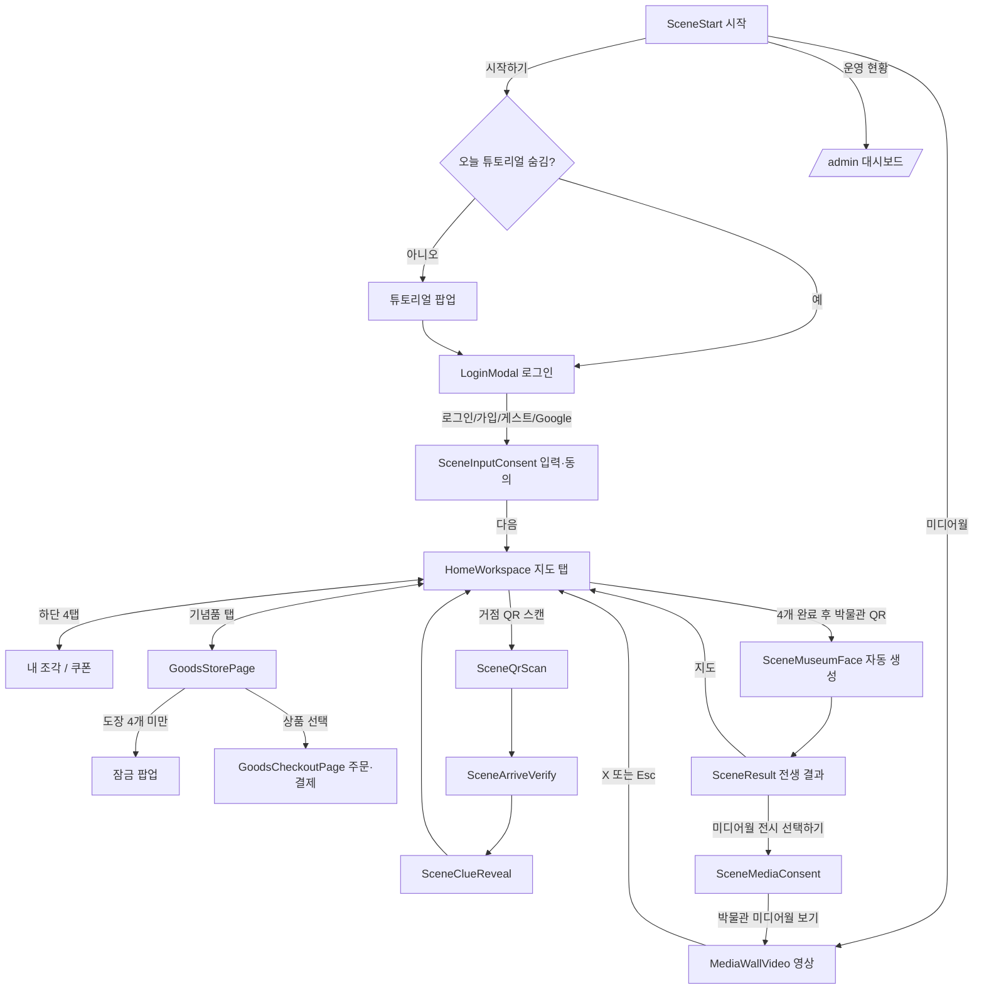

# 전생여지도 세부 기능 명세서

> 기준: 로컬 저장소의 현재 소스. 웹캠 촬영·얼굴 동의·구버전 `/wall` 카드 갤러리는 삭제되어 명세에서 제외했습니다.
> `SceneQrScan`의 카메라는 **QR 코드 인식 전용**이며 얼굴·사진을 저장하지 않습니다.
> 값은 모두 현재 코드의 상수·문구를 옮겼습니다. 확인하지 못한 동작은 "미확인"으로 표시했습니다.

## 1. 화면 구성도(IA) 및 화면 흐름도

### 1.1 장면(Scene) 구성

| SceneId | 컴포넌트 | 설명 | 공통 상단 배너 | 하단 4탭 |
| --- | --- | --- | --- | --- |
| 1 | `SceneStart` | 시작 화면(로고, 달항아리 캐릭터, 사극 인사말, `시작하기`, 상단 `미디어월`·`운영 현황`) | 숨김 | 없음 |
| 2 | `SceneInputConsent` | 이름·생년월일·권한 안내 체크, 이전 기록 불러오기 | 없음 | 없음 |
| 3 / 4 / 5 | `HomeWorkspace` | 지도 / 내 조각 / 쿠폰 탭 | 표시 | 표시 |
| 6 | `SceneQrScan` | 거점 QR 인증(카메라·사진·이미지 파일) | 없음 | 표시 |
| 7 | `SceneArriveVerify` | 도착(위치) 확인과 조각·쿠폰 수령 | 없음 | 표시 |
| 8 | `SceneClueReveal` | 획득한 조각·쿠폰 공개 | 없음 | 표시 |
| 9 | `SceneMuseumFace` | 박물관 인증 후 결과 자동 생성 전환 화면 | 없음 | 표시 |
| 10 | `SceneResult` | 전생 결과(이미지·음성·스토리) | 표시 | 표시 |
| 11 | `SceneMediaConsent` | 미디어월 전시 Yes/No 팝업과 완료 안내 | 없음 | 표시 |
| (별도) | `GoodsStorePage` / `GoodsCheckoutPage` | 기념품 스토어 / 주문·결제 | 표시 | 표시 |
| (오버레이) | `MediaWallVideo` | `/videos/mediawall.mp4` 전체 화면 영상 | 숨김 | 없음 |
| (라우트) | `AdminDashboardPage` | `/admin` 운영 현황 | 자체 헤더 | 없음 |

### 1.2 전체 화면 흐름도



## 2. 기능별 세부 명세

### F-01. 서비스 진입 및 사용자 인증

| 항목 | 내용 |
| --- | --- |
| 기능 ID | F-01 |
| 기능명 | 서비스 진입 및 사용자 인증 |
| 관련 파일/컴포넌트 | `SceneStart.tsx`, `LoginModal.tsx`, `TutorialModal.tsx`, `SceneInputConsent.tsx`, `utils/authHandlers.ts`, `utils/authCrypto.ts`, `utils/tutorialStorage.ts`, `App.tsx` |
| 사전 조건 | 브라우저(sessionStorage·localStorage 사용 가능). Google 실제 로그인은 `.env`의 `VITE_GOOGLE_CLIENT_ID`와 Google Cloud의 승인된 JavaScript 원본(예: `http://localhost:3000`)이 필요 |
| 상세 동작 및 UI 처리 | ① 시작 화면에서 `시작하기`를 누르면 로그인 모달이 열린다. ② 로그인 탭: 아이디·비밀번호 입력(기본 데모 계정 `jeonju` / `1234`, 표시 이름 전주여행자, 모달에 안내문구 표시). 간편 회원가입 탭: 로컬 회원가입(비밀번호는 해시 저장). ③ 간편 로그인: Google·카카오·네이버 원형 버튼과 `게스트 로그인`. Google은 클라이언트 ID가 있으면 공식 버튼(GIS)이 원형 버튼 위에 투명하게 겹쳐 실제 Google 로그인 팝업이 뜨고, JWT에서 이름·이메일·프로필 이미지를 읽어 세션에 저장한다. 클라이언트 ID가 없으면 콘솔 안내를 남기고 `Google 체험자`로 진행한다. 카카오·네이버는 로컬/개발 모드에서 체험 계정으로 진행한다. ④ 로그인 성공 후 "오늘은 다시 이 창을 보지 않음"이 설정되어 있지 않으면 튜토리얼 4단계 팝업(체험 시작·단서 수집·전생 확인·혜택 및 기록)을 보여 주고, `확인하고 시작하기`로 입력 화면으로 이동한다. ⑤ 입력 화면에서 이름(최대 16자, 비우면 "전주 나그네"), 생년월일(F-04의 달력), 위치·카메라 권한 안내 체크 두 개를 완료하고 `다음`을 누르면 체험 세션이 만들어져 지도 탭으로 간다. ⑥ 공통 상단 배너의 `↻`는 처음 화면으로 돌아가며, 기록은 같은 탭에서 보관된다(복구 코드는 로컬 모드에서 발급하지 않는다). 새 체험 시작 시 고정된 전생 캐릭터가 해제된다. |
| 예외/엣지 케이스 처리 | 잘못된 아이디·비밀번호는 `아이디 또는 비밀번호가 올바르지 않습니다.` 표시. 권한 체크 누락 시 `위치와 카메라 권한 허용 안내에 모두 체크해 주세요.` 생년월일 형식 오류·1910년 미만·미래 연도·존재하지 않는 날짜는 `validateBirthDate`가 각각 안내 문구로 거절. Google 401 `invalid_client`는 코드 오류가 아니라 승인된 원본 미등록이므로 Cloud Console 설정이 필요(클라이언트 ID를 비우면 체험자 폴백). 세션은 `sessionStorage`라 탭을 닫으면 사라진다. 로컬 모드 `/api/auth/recover`는 404로 안내. 서버 모드가 아니면 로그인 스텁이 막혀 `로그인 연동 준비 중입니다. 게스트 로그인으로 이용해 주세요.` 표시 |

### F-02. 공통 상·하단 내비게이션 및 반응형 레이아웃

| 항목 | 내용 |
| --- | --- |
| 기능 ID | F-02 |
| 기능명 | 공통 상·하단 내비게이션 및 반응형 레이아웃 |
| 관련 파일/컴포넌트 | `TopExperienceHeader.tsx`, `BottomNav.tsx`, `HomeWorkspace.tsx`, `App.tsx`(`withNav`, `handleNavTab`), `index.css`, `index.html` |
| 사전 조건 | 체험 세션이 시작된 상태(장면 3 이후) |
| 상세 동작 및 UI 처리 | **상단 배너**: 좌측 `[프로필] {모은 조각}/4`, 데스크탑에서 `· {이름}`, 폭 360px 이상에서 `· 현장 체험`. 우측 `미디어월`(영상 오버레이 열기, 모든 화면 동일), `skip`(F-03), `↻`(처음으로). 지도·내 조각·쿠폰·기념품·결제·전생 결과에서 동일하게 유지되고, 시작 화면과 미디어월 영상 오버레이에서는 렌더하지 않는다. **하단 4탭**: `지도`·`내 조각`·`쿠폰`·`기념품`, `fixed bottom-0`, 현재 탭 `aria-current="page"`·강조선. 도장 4개 미만이면 `기념품` 아이콘에 자물쇠 배지와 `기념품 (잠김)` 라벨. 탭은 자유롭게 오갈 수 있고 탭 전환 시 미디어월 오버레이는 닫힌다. **레이아웃**: 상단 배너·서브 헤더·본문·하단 탭 내부 컨테이너가 `max-w-5xl px-4 sm:px-6`로 정렬. 본문 하단에 `calc(7rem + env(safe-area-inset-bottom))` 여백. **반응형**: 루트 `font-size: clamp(14px, calc(13px + 0.25vw), 16px)`, `html, body, #root`에 `min-width: 320px`(미만에서는 가로 스크롤), `word-break: keep-all`. 모달 카드는 `w-[calc(100vw-2rem)] max-w-[430px]`. 제목류는 `clamp()`로 유동. 헤더·탭 항목에 `shrink-0`/`whitespace-nowrap`/`min-w-0`을 적용해 320~430px에서도 한 줄 유지 |
| 예외/엣지 케이스 처리 | 320px 미만 창은 레이아웃이 줄어드는 대신 가로 스크롤이 생긴다. 폭 360px 미만에서는 `· 현장 체험` 텍스트를 숨긴다. 사용자명이 길면 말줄임(`truncate`). 하단 탭 라벨이 길어지면 말줄임. QR 스캔·도착 인증·조각 공개·박물관 단계·미디어월 전시 선택 화면에는 상단 배너가 없다(하단 탭은 있음). 노치 기기에서는 `env(safe-area-inset-bottom)`만큼 여백 추가 |

### F-03. 전주 전통 여지도 및 거점 스탬프 인증

| 항목 | 내용 |
| --- | --- |
| 기능 ID | F-03 |
| 기능명 | 전통 여지도 및 거점 스탬프 인증 |
| 관련 파일/컴포넌트 | `HomeWorkspace.tsx`(지도 탭), `SceneQrScan.tsx`, `SceneArriveVerify.tsx`, `SceneClueReveal.tsx`, `data/jeonjuSpots.ts`, `data/qrAllowlist.ts`, `utils/pastLifeEngine.ts`, `utils/localApi.ts`, `config/features.ts` |
| 사전 조건 | 체험 세션 존재. 위치 인증은 거점 반경 내 GPS(완판본 240m·경기전 220m·남부시장 240m·전라감영 220m·박물관 300m), 또는 QR 인증 |
| 상세 동작 및 UI 처리 | **지도**: 전통 여지도 이미지 위에 5개 핀이 `mapPositionPercent` 좌표로 놓인다(1 완판본 80/68, 2 경기전 56/54, 3 남부시장 40/74, 4 전라감영 46/33, 박물관 24/18). 두 겹 SVG 점선 `M 80 68 L 56 54 L 40 74 L 46 33 L 24 18`이 ①→②→③→④→박물관을 잇는다. 지도 위에 추천 관람 순서 바(`①완판본문화관 → ②경기전 → ③남부시장 → ④전라감영 → ⑤국립전주박물관`)와 "추천 관람 순서이며, 참고사항" 안내가 있다. 지도 컨테이너는 `aspect-[4/3] min-h-[260px] max-h-[580px]`. **기본 선택 거점**: 첫 진입·`↻` 후 완판본문화관(방문 기록이 없을 때 항상). 핀을 누르면 선택되고 하단 시트에 `장소 N 선택됨`, 거점 이름, `상세 보기`, `QR 스캔`이 나온다. 이미 방문 인증한 거점은 도장 `完`이 찍힌다. **QR 인증**: `QR 스캔`→`SceneQrScan`에서 카메라 인식(`jsqr`), `사진 촬영 인식`, `QR 이미지 선택` 중 하나로 읽고, 허용 목록(`qrAllowlist.ts`)의 해당 거점 URL과 정확히 일치해야 한다(앞뒤 공백만 제거, 대소문자·쿼리 변형 불가). 성공하면 도착 인증 → 조각·쿠폰 수령(`claim`) → 조각 공개 화면을 거쳐 지도로 돌아온다. **박물관**: 조각 4개가 모이면 박물관 핀이 열리고 상세에 `박물관 미디어월 보기`, `박물관 현장 QR 스캔하기`가 나온다. 조각이 4개 미만이면 박물관 핀은 자물쇠로 잠긴다. **`skip`**(시연용): `ENABLE_QUICK_COMPLETE_BUTTON`이 `true`이고 조각이 4개 미만일 때 상단 배너에 초소형 `skip`이 보인다. 누르면 `complete-all-stamps`로 4개 거점 인증·조각·쿠폰이 한 번에 처리된다 |
| 예외/엣지 케이스 처리 | 다른 거점 QR을 읽으면 `WRONG_SPOT_QR`, 허용 목록에 없으면 `UNREGISTERED_QR`, 빈 값이면 `EMPTY_QR`로 안내. 이미 인증한 거점은 409 `이미 방문 인증을 완료한 장소입니다.`. 박물관 QR은 조각 4개 미만이면 `전생 조각 4개를 모두 모아야 국립전주박물관 QR 인증을 진행할 수 있습니다.`로 거절. GPS 좌표를 못 얻으면 안내 문구와 함께 실패(반경 밖이면 현재 거리를 표시). `skip` 실패 시 헤더 아래에 오류 문구. 저장 실패 시 지도 위에 `저장 재시도` 배너. 지도 이미지가 로드되지 않아도 핀·점선은 그대로 동작. 최종 시연 전 `ENABLE_QUICK_COMPLETE_BUTTON = false`로 바꾸면 버튼과 로컬 API가 모두 꺼진다 |

### F-04. 전생 조각 수집 및 한국어 생년월일 입력

| 항목 | 내용 |
| --- | --- |
| 기능 ID | F-04 |
| 기능명 | 전생 조각 수집 및 한국어 생년월일 입력 |
| 관련 파일/컴포넌트 | `HomeWorkspace.tsx`(내 조각 탭), `TangramClueBoard.tsx`, `KoreanDatePicker.tsx`, `SceneInputConsent.tsx`, `utils/pastLifeEngine.ts` |
| 사전 조건 | 생년월일은 입력 화면(장면 2)과 `이전 기록 불러오기` 폼에서 사용. 조각은 거점 인증 후 수령 |
| 상세 동작 및 UI 처리 | **내 조각 탭**: 칠교놀이 보드에 4개 조각 칸(시대=경기전, 신분=전라감영, 이야기=완판본문화관, 소지품=남부시장)이 있고, 수령한 칸이 채워진다. 칸을 누르면 조각 상세(라벨·값·상세·역사 메모)를 볼 수 있다. 상단 배너의 `N / 4`가 진행도다. 조각 값은 생년월일·방문 순서·세션 ID 해시로 5개 원형 중 하나에서 정해진다. **한국어 달력**: 입력 칸은 버튼이며 누르면 팝오버가 열린다. 상단에 `‹` `›`와 연도 드롭다운(올해부터 `min`인 1910년까지), 월 드롭다운, `2026년 11월` 형태 제목, 요일 `일 월 화 수 목 금 토`(일요일 `#8E3524`), 날짜 격자, 하단 `초기화`/`오늘`. 선택일은 `#8E3524` 배경·`#FBF8F1` 글자, 오늘은 `#1B2632` 테두리. 값은 부모와 `YYYY-MM-DD` 문자열로 주고받는다(기존 저장·검증 로직 영향 없음). 날짜를 고르거나 바깥을 누르거나 `Esc`를 누르면 닫힌다. 팝오버 폭은 `min(18rem, 100vw-2rem)`~`min(22rem, 100vw-2rem)`이라 모바일에서 오른쪽이 잘리지 않는다 |
| 예외/엣지 케이스 처리 | `min`/`max` 범위 밖 날짜는 비활성(`max`는 기기 로컬 기준 오늘). 범위 밖 연도로 이동하는 `‹` `›`는 비활성. 값이 비어 있으면 `생년월일을 선택해 주세요` 표시. 형식이 잘못된 값은 빈 값으로 취급. 제출 시 `validateBirthDate`가 최종 검증하며, `<input required>` 네이티브 검증은 쓰지 않는다. 한 달력 안에서 연도를 바꾸면 해당 연도에 존재하지 않는 월은 목록에서 빠진다(최소·최대 연도 한정) |

### F-05. 전생 결과 도출 및 미디어월 영상 오버레이

| 항목 | 내용 |
| --- | --- |
| 기능 ID | F-05 |
| 기능명 | 전생 결과 도출 및 미디어월 영상 오버레이 |
| 관련 파일/컴포넌트 | `SceneMuseumFace.tsx`, `SceneResult.tsx`, `SceneMediaConsent.tsx`, `MediaWallVideo.tsx`, `MediaWallPage.tsx`(영상 래퍼), `data/characters.ts`, `data/charactersData.json`, `utils/localApi.ts`(`handleGenerate`, `handleWallConsent`), `App.tsx` |
| 사전 조건 | 조각 4개 완료 + 박물관 인증(QR 또는 GPS 반경) |
| 상세 동작 및 UI 처리 | **결과 생성**: 박물관 인증 후 `SceneMuseumFace`가 `조각 4개가 하나로 모이고 있어요. 전생을 확인하는 중...` 화면을 보여 주며 자동으로 `/api/past-life/generate`를 호출해(사진·얼굴 데이터 없음) 결과를 만든 뒤 `SceneResult`로 이동한다. 실패하면 재시도 버튼. 캐릭터는 `charactersData.json`에서 직전 캐릭터를 피해 무작위로 골라 체험 동안 고정한다(`getOrPickCurrentCharacter`). **결과 화면**: 상단 배너 아래 서브 헤더(`← 지도` | `{이름} 님의 전생 기록`), 16:9 캐릭터 이미지, 제목, 음성 플레이어(`다시 듣기`, 진행률), `📜 설정`, `🎬 그날의 대화`(대본 형식), `🏆 전생 결과`(직업·평판·업적), `⚰️ 인생 마무리`와 가상 콘텐츠 면책 문구, `다른 전생 확인하기`(다른 캐릭터), 저장·공유 버튼, `미디어월 전시 선택하기`, `네 조각 연결 및 전생 굿즈 안내 보기`. 데스크탑(`lg`)에서는 이미지 영역(좌)과 스토리(우) 2단. **미디어월 전시 선택**: `SceneMediaConsent`에서 "나의 전생을 미디어월에 전시하시겠어요?" Yes/No(`Yes, 미디어월에 전시합니다` / `No, 전시하지 않습니다`). Yes는 별칭·직업·대표 대사만 전시 목록(localStorage)에 저장하고 완료 안내와 `박물관 미디어월 보기`, `동의 철회`, `전생 기념 굿즈 보러가기`를 보여 준다. No는 비공개 안내와 `혜택 쿠폰함 확인하기`. **미디어월 영상**: 시작 화면·지도 헤더·모든 화면의 상단 `미디어월`, 박물관 상세의 `박물관 미디어월 보기`, 전시 완료 화면의 `박물관 미디어월 보기`, 그리고 `/wall` 직접 접속이 모두 같은 `MediaWallVideo`를 연다. 전체 화면 검은 배경에 `/videos/mediawall.mp4`가 `autoPlay`·`loop`·`playsInline`으로 재생된다. 열릴 때 먼저 소리를 켠 채 재생을 시도하고 브라우저가 막으면 음소거로 재생한다. 좌하단 `소리 켜기/끄기` 토글, 우상단 둥근 `X`(`aria-label="미디어월 닫기"`) 또는 `Esc`로 닫으면 체험 중이면 지도 탭으로, 시작 화면에서 열었으면 시작 화면으로, `/wall`로 열었으면 `/`로 돌아간다. 열려 있는 동안 배경 스크롤이 잠긴다 |
| 예외/엣지 케이스 처리 | 조각이 4개 미만이면 생성 API가 400, 박물관 위치 인증 실패는 403. 영상 로드 실패 시 `미디어월 영상을 불러오지 못했습니다.` 안내(파일 위치 `public/videos/mediawall.mp4`). 영상 코덱은 H.264여야 모든 브라우저에서 재생된다(HEVC 원본은 변환 필요). 결과가 없는 상태에서 장면 10·11로 진입하면 렌더하지 않는다. 동의 저장·철회 실패 시 오류 문구. `charactersData.json`에 캐릭터가 1종뿐이면 직전 캐릭터 제외 규칙이 풀이 비어 같은 캐릭터를 다시 쓴다. 이미지는 `characterId`로 조회하며, 없으면 기존 `portraitDataUrl`을 쓴다 |

### F-06. 전주 제휴 쿠폰 발급함

| 항목 | 내용 |
| --- | --- |
| 기능 ID | F-06 |
| 기능명 | 전주 제휴 쿠폰 발급함 |
| 관련 파일/컴포넌트 | `HomeWorkspace.tsx`(쿠폰 탭), `CouponBarcodeModal.tsx`, `CouponCategoryBadge.tsx`, `data/coupons.ts`, `data/jeonjuSpots.ts`(`INITIAL_DEMO_COUPONS`), `utils/localApi.ts`(`assignRandomCoupons`), `utils/couponBarcode.ts` |
| 사전 조건 | 거점 인증으로 해당 쿠폰 슬롯이 해금되어야 함(거점 4곳 = 쿠폰 슬롯 4개) |
| 상세 동작 및 UI 처리 | 쿠폰 탭 상단에 "전주 제휴 쿠폰 발급함" 배너(발급 수 표시), 아래에 거점별 쿠폰 카드가 1열(모바일)·2열(`md` 이상)로 나열된다. 해금 전 카드는 잠금 상태. 해금 시 4대 카테고리(`카페`·`식당`·`숙박권`·`전주 지역 상품권`) × 3종 템플릿 중에서 카테고리를 균등 확률로 먼저 고르고 그 안에서 무작위 1종을 발급하며 이미 가진 템플릿은 피한다. 카드에는 카테고리 배지, 매장명(제휴 예정 모델), 혜택, 위치 안내, 유효기간이 표시된다. 카드를 누르면 `CouponBarcodeModal`이 열려 CODE128 바코드와 번호(`JSYJ-DEMO-…`)를 보여 준다. 사용 처리는 `/api/session/{id}/coupons/{couponId}/use`로 저장되고 사용 상태가 카드에 반영된다. 운영 대시보드의 카테고리별 발급·사용 현황에 합산된다 |
| 예외/엣지 케이스 처리 | 아직 해금되지 않은 쿠폰은 바코드를 열 수 없다. 이미 사용한 쿠폰은 `used` 상태로 표시(`toggleCouponUsedState`). 서버 모드의 사용 처리는 관리자 코드(`x-admin-passcode`) 경로를 쓴다. 쿠폰은 모두 시연용(제휴 예정 모델)이며 실제 상점 사용은 불가. 쿠폰 팝업은 쿠폰 키컬러 `#A35139` 테두리를 유지한다 |

### F-07. 기념품 굿즈 스토어 및 주문·결제

| 항목 | 내용 |
| --- | --- |
| 기능 ID | F-07 |
| 기능명 | 기념품 굿즈 스토어 및 주문·결제 |
| 관련 파일/컴포넌트 | `GoodsStorePage.tsx`, `GoodsCheckoutPage.tsx`, `data/goods.ts`, `BottomNav.tsx`, `App.tsx`(`goodsView`, `stampCount`, `goodsLocked`) |
| 사전 조건 | 스토어 열람은 `기념품` 탭(결과 화면 없이도 가능). 잠금 기준은 박물관을 제외한 4개 거점 방문 인증 수(`stampCount < 4` → 잠김) |
| 상세 동작 및 UI 처리 | **잠금 상태(도장 4개 미만)**: 스토어 본문이 `blur-md opacity-65`로 흐려지고 그 위에 어두운 오버레이와 중앙 잠금 팝업이 뜬다(상단 공통 배너는 그대로 보임). 팝업: 라벨 `전생여지도 기념품 방`, 우상단 `X`(→ 지도 탭), 한지·황토 원형 자물쇠, 제목 `아직 전생의 연이 닿지 않았소`, 보조 `네 곳의 전생 도장을 모두 모아야 기념품 방의 빗장이 열리옵니다.`, 쪽빛 배지 `현재 모은 도장: N / 4개`, 버튼 `지도로 돌아가 도장 모으기`(→ 지도 탭). 글자 크기는 `clamp()`. **해제 상태(4개 완료)**: 상단 배너 아래 서브 헤더(`전생여지도 기념품 굿즈 스토어`, `나의 전생을 담은 기념품 14종`, `X`→지도 탭)와 14종 카드 그리드(1열/`sm` 2열/`lg` 3열). 카드: 16:9 이미지(`클릭하여 결제` 표식), 이름, 한 줄 설명, 가격(원). 이미지를 누르면 결제 화면으로 이동. **결제 화면**: 서브 헤더(`← 굿즈 목록으로`, `주문 · 결제`, `X`), 주문 상품과 수량 조절, 수령 방식(`현장 수령 (국립전주박물관 굿즈샵)` / `택배 배송`), 결제 수단(`카카오페이`·`네이버페이`·`토스페이`·`신용·체크카드`), 하단 고정 `{금액} 바로 결제하기`. 누르면 약 1.6초 처리 화면 후 `결제 완료 및 굿즈 교환권`과 시연용 교환권 바코드·현장 수령 안내가 나온다. 실제 외부 결제나 청구는 없다 |
| 예외/엣지 케이스 처리 | 결제 처리 중에는 뒤로가기·닫기·결제 버튼이 비활성. 수량은 최소 1. 하단 결제 바는 하단 내비 위에 붙고 본문에 충분한 하단 여백이 있어 마지막 카드가 가려지지 않는다(1280px·375px에서 마지막 카드 하단과 내비 사이 간격 확인). 도장이 모이는 중에 `skip`을 누르면 잠금이 즉시 풀린다. 잠금 화면 뒤 목록은 `pointer-events-none`/`aria-hidden`이라 조작할 수 없다. 결제 화면의 `X`와 완료는 전생 결과가 있으면 결과 화면, 없으면 지도 탭으로 돌아간다(스토어의 `X`는 항상 지도 탭) |

### F-08. 운영자 대시보드 (참고)

| 항목 | 내용 |
| --- | --- |
| 기능 ID | F-08 |
| 기능명 | 운영자 대시보드(`/admin`) |
| 관련 파일/컴포넌트 | `AdminDashboardPage.tsx`, `AdminOpsTools.tsx`, `data/adminDummyStats.ts`, `utils/localApi.ts`(`getAdminLiveSnapshot`) |
| 사전 조건 | 로컬 모드에서는 인증 없이 열림(`useState(USE_LOCAL_BACKEND)`). 서버 모드는 관리자 인증 코드 입력 후 `/api/admin/stats` |
| 상세 동작 및 UI 처리 | 시연용 가상 누적 데이터(기준 참여자 1,240명)에 이 브라우저의 체험 기록을 +1 등으로 합산하는 토글(`내 시연 기록 실시간 합산`)이 있다. KPI 4개, 거점별 방문, 전생 캐릭터 분포, 쿠폰 카테고리 현황, 제휴 상점 TOP5 표(가로 스크롤 가능) 등을 보여 준다. 표 셀은 줄바꿈하지 않는다 |
| 예외/엣지 케이스 처리 | 서버 모드에서 인증 코드가 틀리면 오류 문구. 로컬 모드에서 `/api/admin/*`는 503이므로 대시보드는 서버 통계가 아닌 로컬 스냅샷만 쓴다. 숫자 KPI는 `clamp(1.75rem, 4vw, 2.5rem)` |

## 3. 데이터 모델 명세

### 3.1 주요 타입 (`src/types/jeonju.ts` 외)

| 타입 | 주요 필드 |
| --- | --- |
| `SpotId` | `'wanpanbon' \| 'gyeonggijeon' \| 'nambu_market' \| 'jeollagamyeong' \| 'jeonju_museum'` (`ClueSpotId`는 박물관 제외 4개) |
| `SpotDefinition` (요청서의 `JeonjuSpot`에 해당) | `id`, `orderNumber`(1~5), `name`, `hanjaName`, `address`, `coordinates{lat,lng}`, `verifyRadiusMeters`, `clueCategory?`, `clueQuestion?`, `shortSubtitle`, `historicalSummary`, `historicalStory`, `clueConnectionText`, `nextHint`, `mapPositionPercent{x,y}`, `qrCodeValue` |
| `ClueRecord` | `spotId`, `category('era'\|'status'\|'story'\|'item')`, `label`, `value`, `detail`, `historicalNote`, `acquiredAt` |
| `Character` (요청서의 `PastLifeCharacter`에 해당, `data/characters.ts`) | JSON에서 변환: `id`, `title`(=name), `emoji`, `imageUrl`, `audioUrl`, `quote`, `setting`, `dialogue`, `result{job,reputation,achievement}`, `ending` |
| `PastLifeResult` | `sessionId`, `archetypeId`, `title`, `era`, `status`, `storyTitle`, `item`, `oneLineSummary`, `biography`, `clueSynthesisNote`, `characterId?`, `portraitDataUrl`, `generatedAt`, `generationSource('gemini-ai'\|'curated-demo')`, `story?{jobTitle,setting,dialogue[],outcome,ending}`, `historicalDisclaimer`, `recommendedGoods[]` |
| `CouponRecord` | `id`, `spotId`, `category`, `templateId?`, `locationHint?`, `title`, `partnerArea`, `benefit`, `condition`, `expiresLabel`, `unlocked`, `unlockedAt?`, `expiresAt?`, `barcodeNumber?`, `used`, `usedAt?` |
| `GoodsItem` (스토어, `data/goods.ts`) | `id('01'~'14')`, `name`, `desc`, `price(원)`, `imageUrl('/goods/NN.jpg')` — 결과 화면 추천용 `types/jeonju.ts`의 `GoodsItem`(archetypeId·subtitle·priceLabel…)과 별개 |
| `UserSessionState` | `sessionId`, `mode`, `visitorName`, `birthDate`, `companion`, `permissionsAcknowledged{location,camera}`, `visitOrder[]`, `clues`, `coupons[]`, `pastLifeResult`, `mediaWallConsent('pending'\|'accepted'\|'declined')`, `mediaWallEntryId`, `currentScene`, `currentSpotId`, `lastCompletedStep`, `spotVerifiedAt`, `spotAuthentications`, `hasCompletedPastLife`, 타임스탬프 |
| `WallEntry` | `id`, `sessionId`, `visitorAlias`, `title`, `era`, `oneLineSummary`, `characterId?`, `portraitDataUrl`, `publishedAt`, `isDemoSeed` |

### 3.2 `charactersData.json` 스키마 (id를 키로 하는 객체)

```json
{
  "10": {
    "id": "10",
    "name": "관객보다 추임새가 큰 소리꾼",
    "emoji": "🎭",
    "image": "/characters/10.jpg",
    "audio": "/characters/10.mp3",
    "quote": "…대표 대사…",
    "story": {
      "setting": "…", "dialogue": "…(줄바꿈으로 대사 구분)…",
      "result": { "job": "…", "reputation": "…", "achievement": "…" },
      "ending": "…"
    }
  }
}
```

현재 파일에는 위 `10` 항목 하나만 있습니다. 목록은 id 오름차순으로 정렬해 `CHARACTERS`가 되며, 이미지·음성은 항상 이 파일의 경로를 쓰므로 에셋 파일은 `public/characters/`에 둡니다.

### 3.3 브라우저 저장소 키

| 키 | 저장소 | 내용 |
| --- | --- | --- |
| `jeonsaeng:v2:local:session:` + 모드 | sessionStorage | 체험 세션(`UserSessionState`) — 탭을 닫으면 삭제 |
| `jeonsaeng:v2:local:wall` | localStorage | 미디어월 전시 목록(`WallEntry[]`) |
| `jeonsaeng:v2:lastCharacterId` | localStorage | 직전에 나온 캐릭터 id(연속 중복 방지) |
| `jeonsaeng:v2:currentCharacterId` | sessionStorage | 이번 체험에 고정된 캐릭터 id |
| `jeonsaeng:local:auth` | sessionStorage | 로그인 방식·표시 이름(Google은 이메일·프로필 이미지 포함) |
| `jeonju_auth_users` | localStorage | 로컬 계정 목록(비밀번호는 해시) |
| `jeonsaeng_tutorial_hide_until_v1` | localStorage | 튜토리얼 "오늘은 다시 보지 않음" 만료 시각(다음 로컬 자정) |

### 3.4 로컬 API 엔드포인트 (`routeLocal`)

| 경로 | 메서드 | 동작 |
| --- | --- | --- |
| `/api/config/map` | GET | 지도 클라이언트 ID 설정 여부 |
| `/api/auth/me`, `/register`, `/recover`, `/logout` | GET/POST | 세션 조회·등록·(복구 코드는 404)·로그아웃 |
| `/api/session/{id}` | GET/PUT | 세션 조회·저장 |
| `/api/session/{id}/verify-qr`, `verify-spot`, `claim`, `complete-all-stamps` | POST | QR 인증·위치 인증·조각/쿠폰 수령·전체 스탬프 완료(시연) |
| `/api/session/{id}/coupons/{couponId}/use` | POST | 쿠폰 사용 처리 |
| `/api/past-life/generate` | POST | 전생 결과 생성(조각 4개·박물관 인증 필요) |
| `/api/wall/consent`, `/api/wall` | POST/GET | 미디어월 전시 동의·목록 |
| `/api/admin/*` | — | 로컬 모드 503 |

## 4. 알려진 한계 및 점검 항목 (QA 참고)

1. **캐릭터 데이터 1종**: 현재 `charactersData.json`에 `10` 하나만 있어 결과가 항상 같은 캐릭터다. `characters` 관련 단위 테스트 3건(10종 데이터 검증, 직전 캐릭터 비반복, 체험 중 고정)은 이 데이터에서는 통과하지 못한다. 10종 이상으로 복원하면 해소된다.
2. 기존 테스트 중 라이브 HMAC 쿠폰 바코드 검증 1건과 `couponBarcode.test.ts`·`server.ts`의 타입 오류 12건(`tsc --noEmit`)은 이번 기능 작업과 무관한 선행 이슈다.
3. 카메라는 QR 인식에만 사용되며, 박물관 단계에서 사진·얼굴을 수집하지 않는다.
4. 팔레트는 팝업·공통 배너·스토어·결제·결과 화면 위주로 통일했고, 지도·내 조각·쿠폰 본문과 운영 대시보드는 기존 계열 색이 남아 있다.
5. `MediaWallPage.tsx`는 이제 영상 오버레이를 감싸는 래퍼일 뿐이며, 예전 카드 갤러리 UI는 없다.
6. 최종 시연·녹화 전 확인: `ENABLE_QUICK_COMPLETE_BUTTON = false`, `.env`/API 키 커밋 여부, 불필요 파일(`README-1.md`, 미사용 `JeonjuNaverMap.tsx` 등).
7. 결과 화면(`SceneResult`)의 공통 상단 배너·2단 레이아웃은 타입 검사까지만 확인했고, 브라우저 자동 점검은 지도·내 조각·쿠폰·기념품·결제 화면에서 수행했다.
