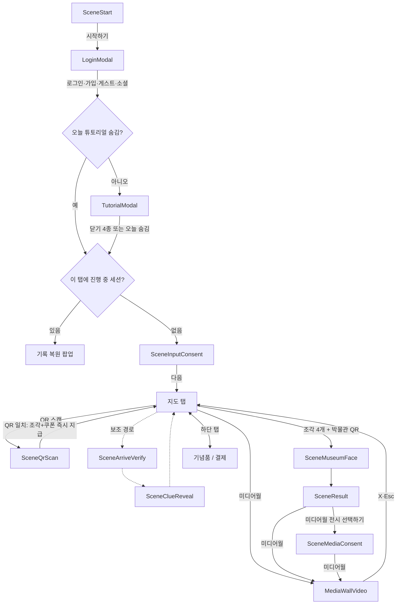

# 전생여지도 세부 기능 명세서 (검증본)

> **기준:** 로컬 저장소 `main` HEAD `b9a5d020`(2026-11-20 07:15) 소스와 그 로컬 빌드. 검증 시각 2026-11-20 09:10 KST.
> **Production(Vercel) 배포본은 이 문서에서 검증하지 않았습니다.** 배포 URL과 배포 커밋을 확인하지 못했기 때문입니다.
> 근거 ID(C·R·BUG)는 `DOCUMENT_FACT_CHECK.md`에 파일:줄과 실행 결과로 정리되어 있습니다.
>
> **상태 표기**
> - **[구현]** 현재 코드에 있고, 표기한 수준으로 확인함
> - **[조건부]** 특정 설정·환경에서만 해당
> - **[시연]** 화면은 있으나 실제 운영 기능이 아님(가상 데이터·가상 결제 등)
> - **[미검증]** 코드나 환경 접근이 부족해 확인하지 못함
>
> 이 앱은 현재 **서버·DB·생성형 AI 없이 브라우저 안에서만 동작**합니다(C01, C15, R05).

---

## 1. 화면 구성(IA)과 흐름

### 1.1 URL 라우트 (C06)

| URL | 화면 | 상태 |
| --- | --- | --- |
| `/` | 체험 앱(장면 1~11) | [구현] |
| `/wall` | 미디어월 영상 전체 화면(`MediaWallVideo`)만 표시 | [구현] |
| `/admin` | 운영 대시보드 — 가상 데이터 기반 | [시연] |

`/wall`, `/admin` 직접 접속은 로컬 미리보기에서 확인했고(R06), Production 동작은 [미검증]입니다.

### 1.2 장면(SceneId)과 공통 UI (C07)

| SceneId | 컴포넌트 | 설명 | 상단 배너 | 하단 탭 |
| --- | --- | --- | --- | --- |
| 1 | `SceneStart` | 시작 화면, `시작하기`, 상단 `미디어월`·`운영 현황` | 없음 | 없음 |
| 2 | `SceneInputConsent` | 이름·생년월일·권한 안내 체크 | 없음 | 없음 |
| 3/4/5 | `HomeWorkspace` | 지도 / 내 조각 / 쿠폰 | 있음 | 있음 |
| 6 | `SceneQrScan` | QR 인식(카메라·사진·이미지 파일) | 없음 | 있음 |
| 7 | `SceneArriveVerify` | 도착 인증(보조 경로) | 없음 | 있음 |
| 8 | `SceneClueReveal` | 조각 상세 공개 | 없음 | 있음 |
| 9 | `SceneMuseumFace` | 박물관 단계 → 결과 조립 | 없음 | 있음 |
| 10 | `SceneResult` | 전생 결과 | 있음 | 있음 |
| 11 | `SceneMediaConsent` | 미디어월 전시 동의 Yes/No | 없음 | 있음 |
| (상태) | `GoodsStorePage` / `GoodsCheckoutPage` | 기념품 / 결제 | 있음 | 있음 |
| (오버레이) | `MediaWallVideo` | 영상 | 없음 | 없음 |

미사용 코드: `MediaWallPage.tsx`(옛 전시 갤러리, C35), `JeonjuNaverMap.tsx`(C50).

### 1.3 전체 흐름 (C02, C03, C11, R04)

---

## 2. 기능별 명세

### F-01. 진입과 로그인

| 항목 | 내용 |
| --- | --- |
| 기능 ID | F-01 |
| 기능명 | 진입·로그인·튜토리얼·입력 |
| 관련 파일 | `SceneStart.tsx`, `LoginModal.tsx`, `TutorialModal.tsx`, `SceneInputConsent.tsx`, `utils/authHandlers.ts`, `utils/tutorialStorage.ts`, `App.tsx` |
| 사전 조건 | 브라우저 sessionStorage·localStorage 사용 가능 |
| 상세 동작 | ① `시작하기` → 로그인 모달 [구현](C02, R04①). ② 로그인 방식: ID·비밀번호(기본 계정 `jeonju`/`1234`가 자동 생성되지만 **화면에 안내 문구는 없음**, C29), 간편 회원가입, 게스트, Google·카카오·네이버 버튼. ③ 로그인 성공 → "오늘은 다시 보지 않음"이 설정돼 있지 않으면 튜토리얼 4단계 [구현](C03, R04②). ④ 튜토리얼의 **Esc·배경 클릭·X·`확인하고 시작하기` 모두 숨김 저장 없이 다음으로 진행**하고, "오늘은 다시 이 창을 보지 않음"은 **누르는 즉시** 다음 로컬 자정까지 숨김을 저장하고 진행 [구현](C04, C05, R04③). ⑤ 이 탭에 진행 중 세션이 있으면 복원 팝업, 없으면 입력 화면. ⑥ 입력 화면: 이름(최대 16자, 로그인 표시 이름이 초기값, 비우면 결과에 "전주 나그네"), 생년월일(F-04), 위치·카메라 권한 **안내 확인** 체크 2개 → `다음` → 지도 [구현](C32, R04④) |
| 로그인의 성격 | **[시연]** 로그인 결과는 이름 초기값으로만 쓰이고, 체험 진행·권한과 연결되지 않습니다(C32). 비밀번호는 브라우저 localStorage에 솔트 없는 SHA-256 해시로 저장되며(비보안 컨텍스트에서는 djb2), 보안 인증 체계가 아닙니다(C28, BUG-03). |
| Google | **[조건부]** 빌드 시 `VITE_GOOGLE_CLIENT_ID`가 있을 때만 Google 공식 버튼이 열립니다. 받은 ID 토큰은 서명 검증 없이 디코드해 이름·이메일·사진만 sessionStorage에 저장합니다(C30, BUG-04). 값이 없으면 "Google 체험자"로 진행합니다. |
| 카카오·네이버·게스트 | **[시연]** 실제 OAuth 없이 "Kakao/Naver 체험자", "게스트 체험자"로 진행(C31). |
| 예외 처리 | 잘못된 ID·비밀번호 안내. 권한 체크 누락 시 안내. 생년월일은 `validateBirthDate`로 형식·1910년~올해·실존 날짜 검사. 로컬 모드의 복구 코드 API는 404 안내. |
| 점검 항목 | Google 로그인 오류(`invalid_client` 등)의 원인은 확인하지 못했습니다 **[미검증]**. 클라이언트 ID 값, OAuth 클라이언트 유형(웹), 승인된 JavaScript 원본에 실제 접속 도메인 등록 여부를 함께 점검해야 합니다. |

### F-02. 공통 상·하단 UI와 반응형

| 항목 | 내용 |
| --- | --- |
| 기능 ID | F-02 |
| 관련 파일 | `TopExperienceHeader.tsx`, `BottomNav.tsx`, `App.tsx withNav`, `index.css`, `index.html` |
| 상단 배너 | `{조각 수}/4`, 이름(sm 이상), `· 현장 체험`(360px 이상), `미디어월`, `skip`(F-03 조건), `↻`. 표시 화면은 1.2 표 [구현](C07) |
| 하단 탭 | `지도`·`내 조각`·`쿠폰`·`기념품`, 도장 4개 미만이면 기념품에 자물쇠 [구현](C26) |
| `↻` | 시작 화면으로 이동. **기록은 지우지 않음**(같은 탭에서 다시 시작하면 복원 팝업) [구현](C08) |
| 반응형 | 루트 글자 `clamp(14px, calc(13px + 0.25vw), 16px)`, `html, body, #root` `min-width: 320px`, `keep-all`, 본문 하단 `calc(7rem + env(safe-area-inset-bottom))` [구현-코드](C45). 320/375/768/1280px 점검은 이전 버전에서 수행했고 **현재 커밋으로는 재점검하지 않음** [미검증] |
| 서체 | Pretendard(jsDelivr)·Noto Sans KR(Google Fonts), 로고 SangSangRock(jsDelivr). 외부 CDN을 못 쓰면 시스템 서체로 대체 [구현](C45, R05) |
| 팔레트 | 팝업·배너·스토어·결제·결과 위주로 `#FBF8F1`/`#8E3524` 계열 적용. 지도·내 조각·쿠폰 본문과 대시보드에는 다른 색 계열이 남아 있음 — **전 화면 통일 아님** |

### F-03. 여지도와 스탬프 인증

| 항목 | 내용 |
| --- | --- |
| 기능 ID | F-03 |
| 관련 파일 | `HomeWorkspace.tsx`, `SceneQrScan.tsx`, `SceneArriveVerify.tsx`, `data/jeonjuSpots.ts`, `data/qrAllowlist.ts`, `utils/localApi.ts`, `utils/pastLifeEngine.ts` |
| 거점 | 완판본문화관(240m) → 경기전(220m) → 남부시장(240m) → 전라감영(220m) → 국립전주박물관(300m). 좌표·지도 위치는 `DOCUMENT_FACT_CHECK.md` 3.1 [구현](C09) |
| 방문 순서 | 추천 순서만 표시. 순서 검사 없음, 자유 방문 [구현](C49) |
| 기본 선택 | 새 체험 시작 시 완판본문화관(`장소 1 선택됨`) [구현](C08, R04④). 기록 복원 시에는 진행 상태에 따라 다른 거점이 선택될 수 있음 [조건부] |
| **기본 인증 경로** | 지도 → `QR 스캔` → 카메라·사진·이미지 파일로 QR 읽기 → 값이 해당 거점 허용 값과 **정확히 일치**하면(앞뒤 공백만 제거) **그 자리에서 조각과 쿠폰을 지급**하고 지도로 돌아와 완료 배너 표시. **GPS 검사 없음** [구현](C10, C11) |
| 보조 경로 | 도착 인증 화면(Scene 7): QR 값이 있으면 QR만, 없으면 브라우저 GPS로 반경 확인 후 지급. 현장 사진 버튼은 파일을 읽지 않고 촬영 여부 표시만 남김 [구현](C12, C39) |
| 검증 위치 | 모든 판정은 **브라우저 안의 JavaScript**(`localApi.ts`)에서 수행. 서버 검증 아님 [구현](C15, R05) |
| 현장성 한계 | QR 허용 값이 공개 단축 URL(`m.site.naver.com/…`)이라 QR 이미지만 있으면 현장 밖에서도 인증 가능 — **현장 방문 증명이 아님**(BUG-01) |
| 박물관 | 조각 4개 미만이면 박물관 핀 잠김, 박물관 QR도 거절(400). 중복 인증 409 [구현](C13) |
| `skip` | **[시연]** `ENABLE_QUICK_COMPLETE_BUTTON = true`(현재 커밋)이고 조각 4개 미만일 때 상단에 표시. 4개 거점 조각·쿠폰을 한 번에 지급(C01, C14, R04⑥). Production 노출 여부 [미검증](BUG-02) |
| 예외 | 다른 거점 QR·미등록 QR·빈 값 각각 안내. 중복 인증 409. GPS 좌표 없음·반경 밖 안내(보조 경로) |
| 실기기 | 모바일 카메라 인식, GPS 판정은 [미검증] |

### F-04. 조각 수집과 생년월일 입력

| 항목 | 내용 |
| --- | --- |
| 기능 ID | F-04 |
| 관련 파일 | `HomeWorkspace.tsx`(내 조각 탭), `TangramClueBoard.tsx`, `KoreanDatePicker.tsx`, `utils/pastLifeEngine.ts` |
| 조각 4종 | 시대=경기전, 신분=전라감영, 이야기=완판본문화관, 소지품=남부시장 [구현] |
| 조각 값 결정 | 5개 원형(암행어사·감영 관리·목판 각수·장터 상인·수문장) 중 하나를 `해시(생년월일 | 첫 방문 거점 | 세션 ID 앞 8자) % 5`로 고르고, 원형에 정해진 문구를 조각 값으로 사용 [구현](C17). **AI 생성 아님** |
| 한국어 달력 | 연·월 선택, 일요일 강조, `초기화`/`오늘`, 값은 `YYYY-MM-DD` 문자열. 범위 1910-01-01 ~ 기기 로컬 오늘 [구현](C48) |

### F-05. 결과와 미디어월

| 항목 | 내용 |
| --- | --- |
| 기능 ID | F-05 |
| 관련 파일 | `SceneMuseumFace.tsx`, `SceneResult.tsx`, `SceneMediaConsent.tsx`, `MediaWallVideo.tsx`, `data/characters.ts`, `data/charactersData.json`, `utils/localApi.ts` |
| 결과 조립 | 박물관 단계에서 앱 내부 `/api/past-life/generate`(이름만 generate)를 호출해 **정적 JSON 캐릭터를 골라 결과를 조립**. 외부 AI·서버 호출 없음, `generationSource: 'curated-demo'` [구현](C16, R05). 박물관 QR 인증이 없으면 GPS 300m 확인 후 진행 [조건부](C47) |
| 캐릭터 선택 | JSON 항목 중 무작위(직전 id 제외, 후보 없으면 전체), 이 탭 세션 동안 고정 [구현](C18). **현재 JSON에는 1종(10번 "관객보다 추임새가 큰 소리꾼")만 있어 모든 사용자에게 같은 결과**이며 `다른 전생 확인하기`도 같은 캐릭터를 보여 줌(C19, R04⑦b, BUG-06) |
| 개인화 범위 | 생년월일 등 입력값은 **조각 텍스트와 추천 굿즈(원형)**에만 영향. 결과 화면의 이미지·음성·스토리는 무작위 캐릭터이며 원형과 연결되지 않음(BUG-07) |
| 결과 화면 | 9:16 초상, 제목, 음성(10.mp3), 설정·대화·결과·마무리, 면책 문구, 결과 카드 이미지 저장·공유, `미디어월 전시 선택하기`, 쿠폰·굿즈 안내 [구현](R04⑦). 얼굴 분석·AI 초상 생성 없음 |
| 전시 동의 | **[시연]** Yes → 이 브라우저 localStorage `jeonsaeng:v2:local:wall`에 항목 저장(id, sessionId, **입력 이름 앞 6자**, 캐릭터 제목, 시대, 대표 대사, 캐릭터 id, 이미지 경로, 시각, 시드 여부 — 11개 필드, 최대 50건). No·철회 → 해당 항목 삭제(C34, R04⑧). **이 목록을 보여 주는 화면이 현재 없고, 다른 기기·박물관 디스플레이로 전송되지 않음**(C35, BUG-05) |
| 미디어월 영상 | 시작 화면·상단 배너·박물관 상세·전시 완료 화면의 `미디어월`과 `/wall`이 모두 같은 고정 파일 `/videos/mediawall.mp4`를 재생. **사용자 결과는 영상에 반영되지 않음** [구현](C36). 소리 켠 재생을 먼저 시도하고, 브라우저가 막으면(`NotAllowedError`) 음소거로 재생. 좌하단 소리 버튼과 브라우저 기본 컨트롤 표시. X·Esc로 닫으면 체험 중이면 지도, `/wall`이면 `/`(C37, R04⑨) |
| 영상 파일 | H.264 High 1920×1080 + AAC-LC 2ch MP4, `moov` 앞쪽 배치, 디코딩 오류 없음(R08). 로컬 Chrome에서 재생·오디오 디코딩 확인(R09). **실제 소리를 귀로 들은 확인, 다른 브라우저·OS, Production 재생은 [미검증]**. 자동재생 정책 때문에 클릭 없이 열면 음소거로 시작할 수 있음 |

### F-06. 쿠폰

| 항목 | 내용 |
| --- | --- |
| 기능 ID | F-06 |
| 상태 | **[시연]** 실제 제휴처가 아닌 "제휴 예정 모델(시연용 가상 쿠폰)"(C21) |
| 발급 | 거점 인증 1곳당 1장. 4개 카테고리(카페·식당·숙박권·전주 지역 상품권) × 3종 = 12종 템플릿 중, 아직 보유하지 않은 템플릿이 남은 카테고리에서 균등하게 고르고 그 안에서 미보유 템플릿을 고름 [구현](C21) |
| 바코드 | CODE128, 번호에 `-DEMO-` 포함 [구현](C22) |
| 사용 처리 | 이 탭 세션의 쿠폰에 `used=true` 기록. 잠금·중복 사용은 409. 매장 POS·서버 연동 없음 [시연](C23) |

### F-07. 기념품 스토어와 결제

| 항목 | 내용 |
| --- | --- |
| 기능 ID | F-07 |
| 잠금 | 박물관 제외 4개 거점 방문 인증 수 < 4이면 잠금 팝업(`지도로 돌아가 도장 모으기`) [구현](C26, R04⑤) |
| 스토어 | 14종, 11,000~49,000원, 이미지 `/goods/01~14.jpg` [구현](C24, R04⑪) |
| 결제 | **[시연]** 수량 1~10, 수령(현장 수령/택배), 결제수단(카카오페이·네이버페이·토스페이·카드) 선택 → 1.6초 처리 화면 → "시연용 결제입니다. 실제 결제·청구는 이루어지지 않았습니다."와 시연용 교환권 바코드. **PG 연동·주문 저장·청구 없음**(C25) |
| 복귀 | 스토어 X → 지도. 결제 X·완료 → 결과가 있으면 결과 화면, 없으면 지도 [구현](C26) |

### F-08. 운영 대시보드 (`/admin`)

| 항목 | 내용 |
| --- | --- |
| 상태 | **[시연]** 하드코딩된 가상 누적 데이터(기준 참여자 1,240명, 유입률·완주율·TOP5 상점 등)(C27) |
| 합산 | 토글이 켜져 있으면 **같은 브라우저 탭의 sessionStorage 체험 기록 1건**을 가상 수치에 더함. 다른 사용자·기기·탭의 집계가 아님(C27, BUG-08) |
| 접근 | 로컬 모드에서 인증 없이 열림(C46). 서버 통계 API는 로컬 모드에서 503 |

---

## 3. 데이터 모델과 저장

### 3.1 주요 타입 (`src/types/jeonju.ts` 외)
- `SpotDefinition`: id, orderNumber, name, coordinates, verifyRadiusMeters, mapPositionPercent, qrCodeValue 등
- `ClueRecord`: spotId, category(era/status/story/item), label, value, detail, historicalNote, acquiredAt, spotPhotoCaptured?
- `Character`: id, title, emoji, imageUrl, audioUrl, quote, setting, dialogue, result{job, reputation, achievement}, ending
- `PastLifeResult`: archetypeId, title, era, status, item, characterId, portraitDataUrl(이미지 경로), generationSource('curated-demo'), story, recommendedGoods 등
- `CouponRecord`: category, templateId, benefit, unlocked, barcodeNumber, used 등
- `GoodsItem`(스토어): id, name, desc, price, imageUrl
- `WallEntry`: id, sessionId, visitorAlias, title, hanjaTitle, era, oneLineSummary, characterId, portraitDataUrl, publishedAt, isDemoSeed

### 3.2 브라우저 저장소 (C33, R04⑩)

| 키 | 저장소 | 내용 |
| --- | --- | --- |
| `jeonsaeng:v2:local:session:experience` | sessionStorage | 체험 세션(이름, 생년월일, 동행, 진행, 조각, 쿠폰, 결과, 전시 동의 상태) |
| `jeonsaeng:local:auth` | sessionStorage | 로그인 방식, 표시 이름, ID, (Google) 이메일·사진 URL |
| `jeonsaeng:v2:currentCharacterId` | sessionStorage | 고정 캐릭터 id |
| `jeonju_auth_users` | localStorage | 로컬 계정(id, 이름, 비밀번호 해시) |
| `jeonsaeng:v2:local:wall` | localStorage | 전시 목록(이름 앞 6자, sessionId 포함) |
| `jeonsaeng:v2:lastCharacterId` | localStorage | 직전 캐릭터 id |
| `jeonsaeng_tutorial_hide_until_v1` | localStorage | 튜토리얼 숨김 만료 시각 |

- sessionStorage는 탭 단위입니다. 보통 탭을 닫으면 사라지지만 브라우저의 탭 복원으로 되살아날 수 있고, 새 탭과는 공유되지 않습니다(일반 브라우저 동작, 직접 시험 안 함).
- localStorage 항목은 사용자가 지우기 전까지 그 브라우저에 남습니다. 공용 기기에서는 다음 사용자에게 남을 수 있습니다(BUG-05).
- 현재 모드에서 서비스 자체 서버로 전송되는 데이터는 없습니다. 외부로 나가는 요청은 폰트 CDN뿐입니다(R05, 로컬 빌드 기준).
- QR 카메라 영상과 선택한 이미지는 브라우저 메모리에서 QR 해독에만 쓰이고, 저장·전송하는 코드는 없습니다(C38).

### 3.3 앱 내부 API (`routeLocal`, C15)
`/api/*` 경로는 **네트워크 API가 아니라** `apiFetch`가 가로채 브라우저 안에서 처리하는 내부 인터페이스입니다. 처리 목록: config/map, auth(me·register·recover·logout), session(GET/PUT), verify-qr, verify-spot, claim, complete-all-stamps, coupons/use, past-life/generate, wall/consent, wall. `/api/admin/*`는 503.

---

## 4. 배포와 실행

| 항목 | 내용 | 상태 |
| --- | --- | --- |
| Vercel 설정 | `vercel.json`: Vite 프리셋, `bun install --frozen-lockfile`, `bun run build`, 출력 `dist`, 확장자 없는 경로(`/api/` 제외)만 `index.html`로 rewrite. 서버리스 함수·DB 없음 | [구현-파일](C43, R07) |
| 로컬 빌드 | 성공, `dist`에 영상·이미지·음성 포함 | [구현](R03) |
| Production | URL·배포 커밋·화면 동작 | **[미검증]** |
| 서버 경로 | `server.ts`(Express) + SQLite 파일 DB(`.data/jeonsaeng.db`) + Gemini(플래그). 상시 실행 Node 서버와 쓰기 가능한 디스크가 필요해 현재 Vercel 정적 배포에서는 실행되지 않음. 이번에 실행 검증하지 않음 | 코드만 존재(C40) |
| 품질 지표 | `tsc --noEmit` 오류 12건, `bun test` 45건 중 4건 실패 (2026-11-20 재실행) | [구현](R01, R02) |

## 5. 알려진 한계 (발표·QA 참고)
1. 캐릭터 데이터 1종 → 모든 결과 동일(BUG-06)
2. 조각(원형)과 최종 캐릭터 불일치 가능(BUG-07)
3. QR 인증은 현장 방문 증명이 아님(BUG-01)
4. skip 버튼이 현재 커밋에서 켜져 있음(BUG-02)
5. 로그인은 시연용(BUG-03, BUG-04)
6. 전시 동의 목록은 표시되지 않고 브라우저에만 남음(BUG-05)
7. 대시보드 수치는 가상 데이터(F-08)
